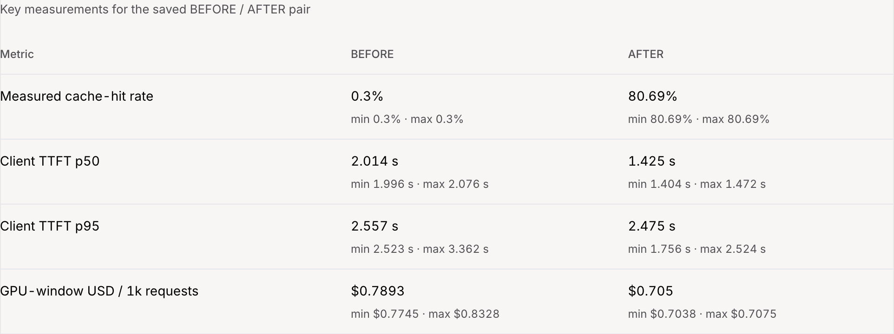
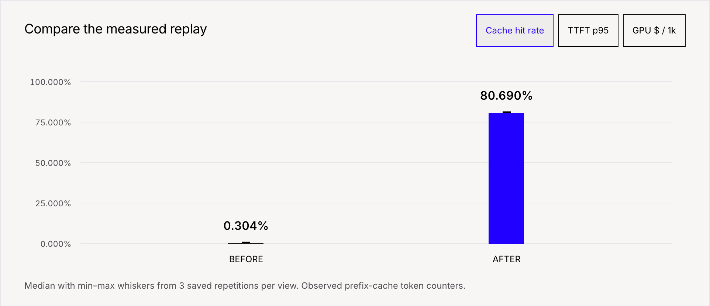
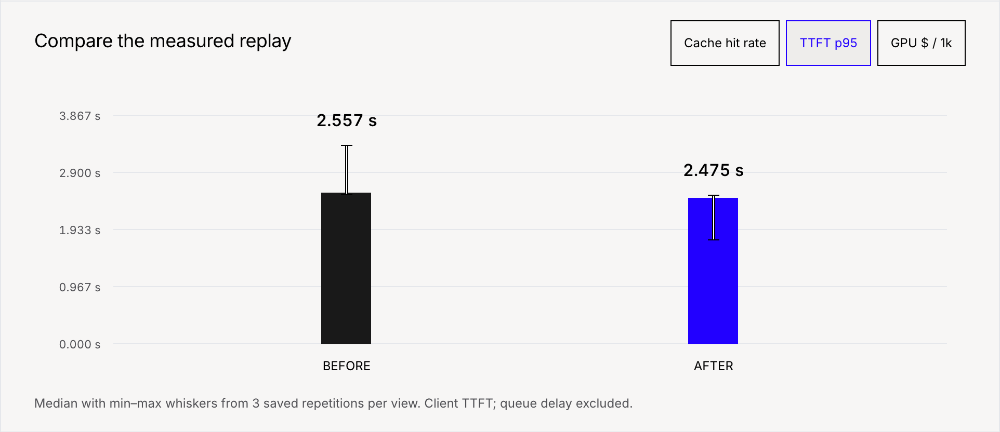
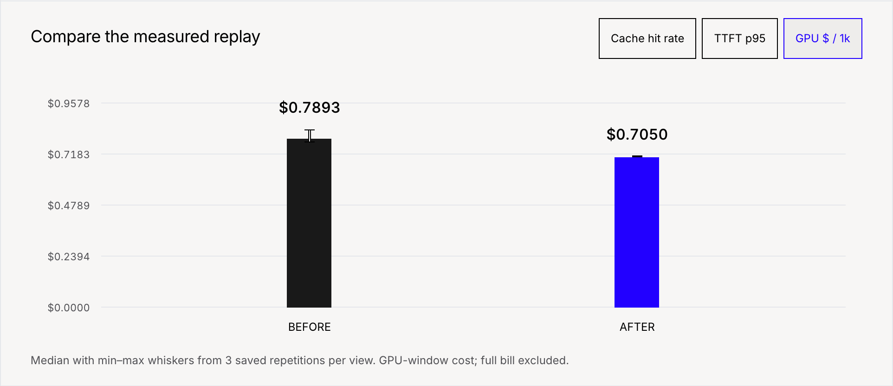
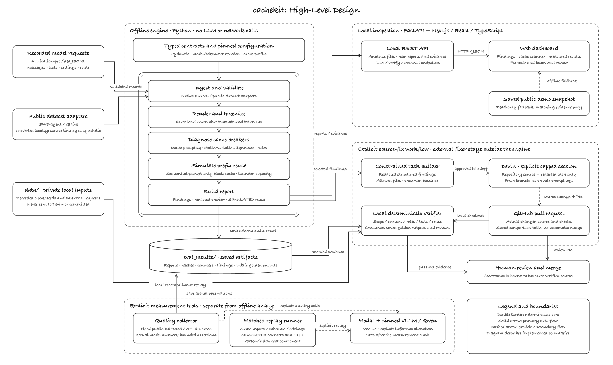

# cachekit

Find what breaks prompt caching. Turn the fix into a measured, behavior-checked code change.

Built at **Devin Hacks Kochi**. Python CLI, local web dashboard, explicit Devin handoff, and saved vLLM replay evidence.

**Track 2 — MAKE THE INVISIBLE VISIBLE**

CacheKit reveals work that is easy to miss: small changes near the start of a prompt can cause thousands of unchanged tokens to be processed again. It makes those breaks visible, then turns detection into action through a scoped Devin code-fix task, a pull request, behavioral checks and measured BEFORE/AFTER results.

## Overview

An AI support assistant may send the same company handbook with every request. If a changing timestamp, customer identity or retrieved passage appears before that handbook, the inference server loses much of the shared input prefix and repeats work.

cachekit reads recorded requests, identifies where reuse breaks, simulates a better layout, and prepares a constrained source-refactoring task. The analysis is deterministic and offline. Actual model evaluation and Devin sessions are separate, explicitly invoked steps.

## Problem statement

- Small changing fields can invalidate a long shared prefix, even when most of the prompt is unchanged.
- The fix lives in application code: prompt builders, tool serialization and conversation handling.
- Moving content can alter model behavior. A higher cache-hit rate alone does not establish a correct fix.
- Estimated reuse, measured latency and actual infrastructure cost are different claims.

## How it works

| Stage | What cachekit does |
| --- | --- |
| Capture | Consume local JSONL requests or converted public-dataset samples. |
| Diagnose | Group call sites, align stable/variable content and map changes to exact tokenizer positions. |
| Simulate | Replay a sequential, capacity-limited vLLM prompt-prefix cache and estimate eligible rearrangements. |
| Fix | Export redacted findings and source constraints for a coding agent; Devin can open a capped, explicitly authorized PR. |
| Verify | Check preserved content/tools/roles, source scope, reuse target, project tests and required golden-case evidence. |
| Measure | Replay matching BEFORE/AFTER traffic on a pinned server and save counters, timings and the GPU-window cost component. |

Prefix caching reuses input-processing computations, not a previous user's answer. The inference server implements the cache; cachekit diagnoses whether the application makes that cache reusable.

## Why Devin is core to CacheKit

Devin is the source-fixing part of the workflow. CacheKit identifies wasted prompt processing, but fixing it requires changes to the application's prompt builder, tool ordering or conversation handling. CacheKit turns those findings into a scoped task with allowed files, a reuse target and verification requirements. An explicitly authorized, capped Devin session can inspect the repository, make the change on a branch and open a PR. Private request logs stay local.

I wanted to use Devin inside the product, beyond helping me build it: give it a concrete engineering problem and a way to check the result. In [PR #2](https://github.com/mohi-devhub/cachekit/pull/2), Devin produced the initial cache refactor. The behavior guard then exposed issues that I repaired and reviewed before merging. A second session produced [PR #3](https://github.com/mohi-devhub/cachekit/pull/3), an optional, unmerged command for comparing saved replay evidence, with eight focused tests.

CacheKit provides the diagnosis and checks; Devin turns the task into a reviewable source change. Human review remains required. The current demo does not claim that Devin completed every repair or ran the full CacheKit verification loop autonomously.

## Measured results

Controlled fictional helpdesk traffic: **27 requests per repetition, three sequential repetitions per view**, using unquantized **Qwen3-4B-Instruct-2507 on one L4**, vLLM **0.31.0**, and a **16,384-token context limit**.

| Metric | BEFORE median | AFTER median |
| --- | ---: | ---: |
| Cached input-token fraction | 0.304% | 80.690% |
| Client time to first token · p50 | 2.014 s | 1.425 s |
| Client time to first token · p95 | 2.557 s | 2.475 s |
| GPU-window USD / 1,000 requests | $0.7893 | $0.7050 |

Source: immutable [BEFORE replay](eval_results/before_replay.json), [final repaired AFTER replay](eval_results/after_confirmation_replay.json), and [derived fact sheet](eval_results/setup/demo_fact_sheet.json). Each headline is a median across repetition results; the screenshots and artifacts include min/max.

The final candidate includes declared calendar and confirmation-behavior repairs alongside the cache refactor. These measurements compare that repaired candidate with the original; they do not isolate the effect of a single text movement.

**Scope:** one request was in flight at a time. TTFT excludes client scheduling wait. GPU-window dollars apply the saved base GPU rate to the measured allocation window; they exclude startup, warmup, idle outside that window, CPU, memory, storage and modifiers. This is a small trace, not a concurrency benchmark or a full cloud bill.

### Benchmark screenshots

Actual dashboard captures of the saved artifacts, with the local API and external services blocked:



<details>
<summary>Cache reuse, first-token latency and GPU-cost charts</summary>







</details>

## Behavioral regression checks

The required five-case guard covers time/date handling, French responses, return/escalation confirmation, retrieved facts and conversation continuity. It evaluates saved actual model outputs, JSON validity where required, completion and explicit assertions. Changed outputs require human review.

The guard caught an omitted authorization commitment during refactoring. The original failure remains in [the evidence](eval_results/attempts/confirmation-omission-v2/README.md). A declared instruction restoration and calendar repair were checked and accepted for their recorded source; see the [review packet](eval_results/accepted_confirmation/review_packet.md) and [saved verification](eval_results/current_fix_verify.json).

Five passing cases support those tested behaviors. They do not prove universal equivalence. Later source changes require fresh verification before a new approval.

## High-level design



[Full-resolution SVG](assets/high-level-design.svg) · [diagram source](scripts/render_architecture.py)

The double-bordered engine runs without network or LLM calls. Explicit benchmark/quality collectors call the approved model endpoint. Devin receives a constrained redacted task and repository source; private request logs stay local. The dashboard inspects saved evidence and never starts a GPU or Devin session by itself.

## Tech stack

| Layer | Tools |
| --- | --- |
| Deterministic pipeline and CLI | Python, uv, Pydantic, Typer, custom alignment/classification and block-cache simulation |
| Rendering and tokenization | Transformers, tokenizers, pinned local Qwen chat template |
| Local API | FastAPI, Uvicorn, typed JSON contracts |
| Explicit inference and measurement | Modal, vLLM, Qwen, httpx, server token counters and streamed timings |
| Source-fix workflow | Devin API, GitHub branches/PRs, deterministic verification and human review |
| Dashboard | Next.js, React, TypeScript, custom CSS; GSAP and Anatomy SVG geometry |
| Checks | pytest, Ruff, ESLint, TypeScript and actual browser/offline checks |

Fonts are self-hosted; the saved demo needs no font/CDN service. UI dependency and asset terms are listed in [third-party notices](web/THIRD_PARTY_NOTICES.md). The Anatomy geometry kit retains its [MIT license](web/src/components/iso/LICENSE).

## Quick start

Clone the repository and run the following commands from its root:

```sh
git clone https://github.com/mohi-devhub/cachekit.git
cd cachekit
```

### View the saved dashboard

Requires **Node.js 22.18+**. No API key, tokenizer download, GPU or Python process is needed for read-only saved playback.

```sh
npm --prefix web ci
npm --prefix web run build
npm --prefix web run start -- --hostname 127.0.0.1
```

Open **http://localhost:3000**. Follow Findings → Heatmap → Verify → Benchmarks. The BEFORE/AFTER scanner, recorded golden outputs and measured charts work without external internet after setup; the local web server must remain running.

### Run local analysis

Use **Python 3.12** (the validated version), **uv**, and **Node.js 22.18+**. Setup needs internet to download dependencies and the pinned tokenizer; subsequent analysis is offline. No model weights or API keys are required.

```sh
UV_PYTHON=3.12 bash scripts/setup.sh
bash scripts/demo.sh
```

The demo script writes a fresh synthetic CPU analysis under ignored `data/quickstart/` and `eval_results/quickstart/`; it does not overwrite the saved measured experiment.

For interactive local uploads, keep the web server from the dashboard section running and start the API in another terminal:

```sh
bash scripts/run-api.sh
```

Bind this unauthenticated operator API to loopback. Private inputs and uploaded reports remain under ignored local directories. To populate the built-in local helpdesk dataset in a fresh checkout:

```sh
uv run --no-sync python -m demo_app.traffic --users 6 --seed 42 --out data/demo
```

For a compatible request file:

```sh
uv run --no-sync cachekit schema
uv run --no-sync cachekit analyze data/demo/requests_before.jsonl \
  --tokenizer data/tokenizer --out eval_results/local/report.json
```

The implemented validated analysis profile is text/full-attention vLLM with the pinned Qwen tokenizer. Other provider names in the request schema do not imply native OpenAI/Anthropic cache simulation.

## From diagnosis to a PR

1. Record outgoing messages, tools, settings, timestamps and call-site labels locally.
2. Analyze the requests and inspect the findings in the CLI or dashboard.
3. While the unchanged application still reproduces its BEFORE requests, freeze a baseline with recorded inputs and meaningful golden cases.
4. Export the redacted task, authorize a capped fixer session and review its source change.
5. Collect actual behavioral evidence separately; verify preserved content, scope, tests and simulated reuse locally.
6. Measure a matched replay, review the exact verified diff, then merge through the repository's normal workflow.

The built-in source-fix replay adapter is helpdesk-specific. Another application needs its own deterministic input/replay integration. This checkout already contains the helpdesk fix: use the saved task for inspection; it cannot recreate the original private baseline from old BEFORE logs.

[Devin PR #2](https://github.com/mohi-devhub/cachekit/pull/2) contains the initial refactor followed by maintainer repairs and accepted evidence. [PR #3](https://github.com/mohi-devhub/cachekit/pull/3) is an unmerged follow-up adding an offline saved-replay comparison command, with the actual comparison table and reported focused checks. It is not another prompt optimization or a new inference experiment.

`DEVIN_API_KEY` stays in ignored `.env`. Ordinary analysis never launches Devin. The local dashboard is useful for diagnosis/review; repeatable organizational workflows can use the CLI and source control. It is not a hosted multi-tenant control plane or an automatic tracing SDK.

## Additional experiments and data sources

The [GPT Researcher controlled-input experiment](eval_results/gpt_researcher/README.md) preserves its pinned upstream patch, actual outputs and failed checks. Two conservative checks failed in both variants, so its candidate remains unapproved and performance replay was not collected. No measured GPT Researcher gain is claimed.

Public datasets used for local preparation/conversion: [SWE-agent trajectories](https://huggingface.co/datasets/nebius/SWE-agent-trajectories), [Glaive function calling](https://huggingface.co/datasets/glaiveai/glaive-function-calling-v2), and [WildChat](https://huggingface.co/datasets/allenai/WildChat-1M). Raw downloads and dataset-derived previews are not committed. The public helpdesk demonstration uses fictional seeded inputs.

## Checks and limitations

```sh
# Focused web checks
npm --prefix web run test
npm --prefix web run typecheck
npm --prefix web run lint
npm --prefix web run build

# Full project validation, when needed
bash scripts/check.sh
```

Recent [UI checks](eval_results/setup/declutter_validation.json) include actual desktop/mobile and offline inspection. Saved verification records identify the source they checked; they are not automatic approval for later commits.

- Simulation is sequential and prompt-only; it omits generated-token cache pressure and concurrent scheduling.
- Finding waste overlaps across causes and must not be added up as causal savings. Classification is heuristic and can miss variants.
- Multimodal, hybrid-attention and LoRA identity support are not validated; oversized requests fail rather than being silently truncated.
- Redacted previews are diagnostic aids, not guaranteed complete privacy filtering. Keep private inputs/results local; remote fix tasks exclude raw prompt text.
- Behavioral assertions are bounded checks, not an LLM judge or universal safety proof.
- The old measured artifacts and approvals describe their recorded requests/source. Final checkout approval requires its own applicable evidence.

Detailed instructions: [explicit benchmark/quality runners](bench/README.md), [local dashboard/API](web/README.md), [screenshot index](screenshots/README.md).
