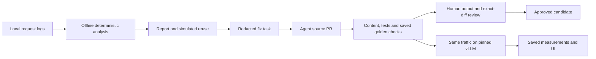

# cachekit

**Find what breaks prompt caching in your LLM app, fix it with an agent, and prove the speedup on vLLM.**

> Status: in development at Devin Hacks Kochi (Oct 24–25, 2026). Published figures come from saved runs in `eval_results/`, labeled SIMULATED or MEASURED. Submission is **07:00 IST**; feature freeze is **05:30 IST**.

Participant: Mohith ([mohi-devhub](https://github.com/mohi-devhub)), solo builder.
Repository initially created from the shared
[hackathon template](https://github.com/anima-regem/devday-kochi-hackathon-template).
No particular template or AI provider is required for this hackathon. Devin and
other AI tools may be used. The shared template referred to an older event;
[current event guidance](RULES.md) and organizer announcements take precedence.
Project records: [submission](SUBMISSION.md), [AI assistance](AI_USAGE.md) and
[changelog](CHANGELOG.md).

## How it works

1. **Analyze:** a deterministic engine reads your rendered prompt logs, finds where requests stop sharing a prefix, labels the cause (timestamp, user identity, tool order, sampled examples, RAG placement, history truncation...), and simulates each backend's cache to compare the hit rate you have with the hit rate you could have.
2. **Fix:** findings become a structured fix task. An agent (Devin, or Codex/Claude) opens a PR that reorders the prompt: stable content first, dynamic content last.
3. **Verify:** cachekit re-renders prompts with the patched code, checks the prefix is stable and nothing was lost, and runs the tests. A human approves the exact diff.
4. **Prove:** the same traffic is replayed through vLLM before and after: cache-hit rate, TTFT, GPU cost per 1,000 requests.

Built on the ideas behind vLLM Automatic Prefix Caching and SGLang RadixAttention.



Only the explicit benchmark/quality collectors call the model. Private logs stay
local; remote fixers receive structured redacted tasks. Simulation, measured
performance, behavioral checks and human approval are separate evidence.


## Results

The [saved benchmark table](eval_results/benchmark_summary.md) is generated from
immutable measured artifacts. An absent AFTER run is shown as pending. The offline analysis fixture and its
run metadata are saved in [eval_results/demo_before_report.json](eval_results/demo_before_report.json)
and [eval_results/demo_before_report.run.json](eval_results/demo_before_report.run.json).
The report detects the planted timestamp, user identity, sampled examples,
retrieval placement, tool order, and history truncation breakers. Its actual and
achievable hit rates are **SIMULATED**; they establish neither speedup nor
behavioral equivalence. The separate Modal smoke test establishes serving and
cache reuse only.

The matched **MEASURED** pair is saved in
[BEFORE](eval_results/before_replay.json) and [AFTER with the confirmation repair](eval_results/after_confirmation_replay.json),
with [generation configuration](eval_results/workload_provenance.json),
[BEFORE provenance](eval_results/before_replay.run.json),
[AFTER provenance](eval_results/after_confirmation_replay.run.json) and serving manifests.
Each run covers 27 synthetic requests per repetition across 3 repetitions.
Values below are medians of the repetition summaries.

| Metric | BEFORE | AFTER with the confirmation repair |
| --- | ---: | ---: |
| Measured prompt-cache hit rate | 0.304% | 80.690% |
| Simulated prompt-cache hit rate | 0.304% | 80.690% |
| Client TTFT p50 | 2.014 s | 1.425 s |
| Client TTFT p95 | 2.557 s | 2.475 s |
| GPU-window USD / 1k requests | $0.7893 | $0.7050 |

This is sequential client replay. Bursty arrivals wait at the client; TTFT starts
at send and excludes that queue delay. GPU-window USD excludes startup, warmup,
reset, idle, CPU, memory and storage, so it is narrower than the complete bill.
The immutable run records its measured source. The confirmation instruction is
included in this AFTER run; [the original AFTER](eval_results/after_replay.json)
and all failed golden attempts remain preserved. [Current source/input provenance](eval_results/current_benchmark_binding.json)
identifies coverage. UI restyling does not relabel a measurement as a new source:
the heatmap shows measured values only when its rendered request hash matches
the saved run. Performance evidence and behavioral approval are separate gates.

Devin opened [the application-fix PR](https://github.com/mohi-devhub/cachekit/pull/2)
in one capped session. The completed candidate retains the full recorded history,
static handbook, selected examples and tool definitions. The required quality
guard found a date-arithmetic error and a lost explicit confirmation commitment.
Mohith authorized the separately documented semantic repairs and accepted the
five resulting golden answers. The unchanged date expectation is false: the
fixture's delivery is outside the handbook window.

[Accepted output evidence and prefix verification](eval_results/accepted_confirmation/review_packet.md)
preserve that checkpoint. [Current source verification](eval_results/current_fix_summary.md)
records subsequent checks and approval status. Approval is tied to an exact
source/diff and current behavioral evidence; historical runs never approve a new
revision. The frozen BEFORE builder keeps planted detection fixtures independent
of changes to the application's current builder.

## Development

Run scripts require Python 3.12+, uv and Node.js 22.18+ (native TypeScript support for the web regression tests):

```sh
bash scripts/setup.sh       # install dependencies and download only the tokenizer
bash scripts/demo.sh        # fresh synthetic traffic and offline analysis
bash scripts/run-api.sh     # local analysis, task and verification API
bash scripts/run-web.sh     # report workspace, in a separate terminal
bash scripts/check.sh       # Python and web validation
```

The setup script uses the network for installation and tokenizer preparation.
The demo runs CPU analysis without inference or an external agent. Open
`http://localhost:3000` for the workspace. A committed synthetic report works
without the API or GPU; analysis and task generation need the local API. Actual desktop/mobile [UI captures](screenshots/README.md) show the saved
BEFORE report, candidate heatmap, quality outcomes and measured replay. Captures
identify which revision they show; later source changes require fresh verification.
Detailed equivalents follow; no credentials are needed for the local synthetic demo. `uv.lock` and
`web/package-lock.json` pin the installed dependency trees. Setup uses locked
Python resolution and `npm ci`; it downloads the pinned tokenizer explicitly.
The local tokenizer needs no PyTorch installation or model weights.

The heatmap uses an Anatomy SVG cache scanner: the probe moves to the exact saved
first-divergence position when switching BEFORE/AFTER. Its colored prompt tape
conservatively groups neighboring saved bins. Deep green is reusable; yellow/slash
contains variation; red/dot is static content recomputed after the break. The
figure is SIMULATED. The cards below use matching saved MEASURED replay medians
and ranges; the scanner does not generate latency or cost estimates. Reduced
motion jumps directly to the saved position, and playback works offline.

Geometry uses the vendored [Anatomy kit](https://github.com/wheresryan22/anatomy)
under its [MIT license](web/src/components/iso/LICENSE). The exact source checksum
is saved in [the source record](eval_results/setup/anatomy_source.json). No new
runtime package, WebGL or external runtime service is required.

The main dashboard emphasizes findings, the cache scanner, key replay measurements
and five behavioral cases. Prompt text, diagnostic tables, smoke-test details and
manual evidence/approval controls are collapsed until requested. Collapsing the
controls does not weaken verification or change approval requirements.

The report cost field uses the matching measured replay median/range (GPU-window
USD per 1k requests), rather than estimating dollars from simulated token counts.

The public demo can replay a recorded AFTER even when live source verification is
stale. Its BEFORE input hash must match the saved workload, and its source is
labeled SAVED. Current-source verification and approval remain separate.

The light UI uses an editorial overview, a desktop side rail and a mobile Menu, with self-hosted Inter, Source Serif 4 and Geist Mono. The benchmark chart switches between measured cache reuse, TTFT p95 and GPU-window cost, with saved min–max whiskers. One adapted React
Bits hero fade and brief summary/count transitions honor reduced motion. Lenis
loads only on the overview for desktop wheel scrolling; reports and prompt/code
panes retain native scrolling. All assets are local after setup/build; no runtime
font/CDN service is required. The web server must still run locally for a cold
page load. An already loaded heatmap can toggle with networking fully disabled.
See [component/font sources and licenses](web/THIRD_PARTY_NOTICES.md).

Install the Python workspace and its development dependencies from the repository root:

```sh
uv sync --locked --all-packages --all-extras
uv run --no-sync cachekit --version
uv run --no-sync cachekit schema --model RequestRecord
```

Generate reproducible, fictional helpdesk traffic:

```sh
uv run --no-sync python -m demo_app.traffic --users 6 --seed 42 --out data/demo
```

This writes recorded inputs, BEFORE requests, and a checksum manifest to gitignored
`data/demo/`. Generation uses the frozen BEFORE builder in
`demo_app/helpdesk/before.py`, which deliberately includes the planted breakers.
The fixer's target is `demo_app/helpdesk/prompt.py`; verification replays that
current builder without changing the frozen detection fixtures.

Prefetch the exact tokenizer once, outside the deterministic engine. No model
weights are needed locally:

```sh
uv run --no-sync hf download Qwen/Qwen3-4B-Instruct-2507 tokenizer.json tokenizer_config.json config.json \
  --revision cdbee75f17c01a7cc42f958dc650907174af0554 --local-dir data/tokenizer
```

Analyze the local requests:

```sh
uv run --no-sync cachekit analyze data/demo/requests_before.jsonl \
  --tokenizer data/tokenizer --out eval_results/demo_before_report.json
```

This validates the tokenizer's downloaded revision and checksums, renders the full
Qwen chat template, detects variable spans and structural breakers, and simulates
the configured vLLM block pool. The report is deterministic; timestamp and run
provenance go in a separate `.run.json` file. Analysis never downloads files or
calls inference. Keep tokenizer download metadata alongside its files. The tokenizer extra also
installs Jinja2, required by Transformers chat-template rendering.

Local dataset adapters are available through `cachekit ingest --source
swe-agent|glaive|jsonl INPUT --out OUTPUT`. Dataset `--limit` counts source rows or
trajectories; a trajectory can produce several requests. Glaive tool-order
planting requires an explicit `--tool-order-fraction`; its default is disabled.
Print the request contract with `cachekit schema --model RequestRecord`.

Task generation preserves the current builder as a baseline **before an application
edit**. This checkout already contains the demo fix. Use `/fix` to inspect its
saved task and actual outputs; a fresh public clone has read-only evidence, not
the original private verification bundle or an automatic current-source approval.

For a new fix, capture requests and recorded inputs from the unchanged application,
analyze them, then prepare the local task before changing that builder. The
current builder must reproduce those BEFORE requests exactly. Giving frozen
BEFORE logs to an already-fixed builder is intentionally rejected. Inspect the
actual command contracts with:

```sh
uv run --no-sync cachekit task --help
uv run --no-sync cachekit fix --help
uv run --no-sync cachekit verify --help
```

Keep each task's baseline, recorded inputs and BEFORE requests under gitignored
`data/`; only the structured redacted task is suitable for a remote fixer.
Verification re-renders the recorded inputs, checks scope/signature/content,
runs tests and evaluates source-bound saved golden outputs. Missing or stale
quality evidence fails closed. Build a fresh baseline and collect actual quality
evidence for a new checkout/source; publishing JSON does not grant approval.

`DEVIN_API_KEY` stays in ignored `.env`. Ask Mohith before starting any new real
Devin session and use an explicit quota cap. One capped session opened PR #2;
its [sanitized handoff](eval_results/devin_handoff.json) retains its original task
identity. Local analysis and verification never launch Devin.

For an explicitly authorized date-arithmetic repair, add
`--calendar-window-days 30` when preparing the task. The fictional handbook uses
that comparison window. This opt-in permits only the exact output of
[`calendar_context`](engine/cachekit/calendar.py), independently recomputed by the
verifier from recorded dates and clock. Original content/tools/roles are still
checked across both recorded traffic and the fixed goldens. Incorrect numbers,
duplicates, misplaced blocks and undeclared additions fail. The facts label date
sources as unverified; they do not authorize a return. Ordinary tasks permit no
such enrichment. Only ISO calendar-date mentions are interpreted; ambiguous
numeric date formats are left unchanged. The arithmetic compares calendar dates
as written with the recorded clock's date, identifies invalid/future dates and
provides closed-window membership (elapsed days from zero through the declared
limit). The formatter emits one flat JSON record per date, with source labels.
Membership describes calendar timing and preserves all other policy checks.

The `helpdesk-e5-lite-v2` suite adds separate checks that the authorization answer
explicitly requires confirmation before creating a return or escalating. These
bounded wording checks accept paraphrases, require both commitments, and do not
replace the no-write-tool and no-unconfirmed-action checks. All five recorded
inputs and the date schema remain unchanged: September 20 to October 24 is
34 days, outside the handbook's 30-day window. V1 artifacts remain historical;
current approval requires evidence for the task's exact suite identity.

An explicitly authorized exception can be declared at task preparation with
`--restore-confirmation-commitment`. This is a **semantic change: restores behavior
lost by reordering, found by the quality guard**, not part of the reorder. The
verifier permits only the exact localized confirmation-response sentence defined
in `fix/content.py`, exactly once in system context. The default remains disabled;
all original content, other additions and behavioral assertions are still checked.
The [original failed v2 run](eval_results/attempts/confirmation-omission-v2/README.md)
is retained. Fresh current-source golden evidence and human review remain required.

The explicit inference runner, `python -m bench.quality --help`, collects only the
versioned public synthetic goldens on local vLLM or Modal. It requires a live
endpoint and deployment manifest; it never submits private traffic. Use
`cachekit review-quality --help` and `cachekit approve --help` for output review
and exact-diff approval. Deployment fields are defined in
[`DeploymentIdentity`](engine/cachekit/fix/models.py). The verifier never starts inference. The fix page distinguishes actual saved
golden outputs, missing evidence, pending reviews and exact-diff approval.

Start the local API and web workspace in separate terminals:

```sh
uv run --no-sync uvicorn cachekit.api:app --host 127.0.0.1 --port 8000
```

```sh
cd web
npm ci
npm run dev
```

Open `http://localhost:3000`. The workspace can select a local converted sample
or upload native `RequestRecord` JSONL, open reports and findings, inspect a
route's stability heatmap, generate a helpdesk fix task, and verify or approve
an exact diff. Run the traffic command above to make `data/demo/` available for
fresh analysis and helpdesk task generation. Other applications still require
a replay adapter; uploading arbitrary logs does not provide one.

The findings page has a **Saved report** selector populated from the local API.
It includes the saved GPT Researcher controlled-input report, historical SWE-agent
traffic and any newly generated runs. The selected dataset and report identity
stay visible, and heatmap links follow that report. External/local reports need
the API; only the public helpdesk snapshot is available offline.

An explicit [GPT Researcher experiment runner](bench/README.md#gpt-researcher-prompt-order-experiment)
captures pinned upstream request construction, prepares a context-last reorder,
and collects separate actual behavioral/performance evidence. It uses controlled
inputs and a fixed Qwen/vLLM profile. A simulated report or passing bounded checks
does not approve that upstream change or establish production savings.
The [saved experiment outcome](eval_results/gpt_researcher/README.md) retains both
actual generation attempts and their failures. Performance replay is blocked:
literal percentage/quoted-marker checks flag rejected examples in both variants,
and human review remains pending. Both experiment GPU deployments are stopped.

Uploads are limited to 10 MiB and stored under ignored `data/api/`; reports,
candidate artifacts, verification provenance and approvals created by the API
stay under ignored `eval_results/local/`. API requests accept artifact identities,
not caller-supplied file paths. Bind this unauthenticated local operator API to
loopback. The benchmark page is a read-only evidence view; there is no public
GPU invocation endpoint or Devin-launch control.

The `/bench` page reads typed saved replay artifacts and smoke counters, checks
that both runs share original inputs, schedule, settings, price and profile, and
shows missing runs explicitly. The heatmap prefers a current-source candidate
with checksum-bound verification. A matching public demo AFTER can also be shown
as SAVED/read-only when live verification is stale or offline. Saved playback
requires the same BEFORE request hash and never grants current-source approval. The `/fix` page exposes actual public synthetic BEFORE/AFTER golden
outputs for review. Generate a fresh task after framework changes; any original
Devin handoff reference retains its original task identity. Attach a saved quality run and any explicit output
review artifacts by SHA-256 under the fix page's evidence section. The API looks
for these typed files in `eval_results/quality_guard/`; verification never starts
inference. Approval recomputes the current gates instead of trusting a saved pass.

When the API is unavailable, the reviewed synthetic report, heatmap, saved
fix status, candidate reports and benchmark counters load from `web/public/demo/workspace.json`. Write
a new synthetic analysis to `eval_results/demo_before_report.json`, then run
`uv run --no-sync python scripts/export_demo.py` to refresh this public snapshot.
Use `python scripts/export_demo.py --task-id <current-task-id>` to select a
registered current task. This export is for an operator workspace with its local
baseline/task bundle; fresh public clones should keep the committed snapshot to
inspect recorded fix evidence. The exporter accepts only the named synthetic helpdesk run.
The summary formatter, `python scripts/summarize_bench.py`, only reads saved
measurements; it performs no inference. Never copy uploaded
or dataset-derived reports into the public demo. After installation, this mode
needs only the local web server; it makes no external font or analytics calls.
See [web/README.md](web/README.md) for routes and API configuration.

Check the engine and demo:

```sh
uv run --no-sync pytest
uv run --no-sync ruff check engine demo_app bench scripts
uv run --no-sync ruff format --check engine demo_app bench scripts
```

In `web/`, run `npm run test`, `npm run typecheck`, `npm run lint`, and `npm run build`.

## Explicit GPU benchmark

The streaming replay runner and single-L4 Modal definition are implemented.
See [bench/README.md](bench/README.md) for deployment, live profile inspection,
BEFORE/AFTER replay, evidence fields and teardown. The runner warms the server,
resets its cache per repetition, checks streamed token accounting, and compares
actual counters with the prompt-only simulator. Ordinary analysis/verification
never starts a GPU or makes inference calls.

Replay artifacts store timing/counter evidence, input/source/config hashes and
repetition summaries. They omit raw prompts and generated answers. The allocated
GPU window and its GPU-only price estimate are explicitly narrower than a full
Modal invoice. The saved table includes repetition min/max beside medians. New source revisions
require their own measurement before those timings can be claimed for them.

## Limitations
- The offline analysis pipeline, local API/report UI, fix workflow, quality
  collector/evaluator and approval gates are implemented. Both measured replay
  artifacts exist for their recorded sources. Current golden/approval status
  comes from saved artifacts; a PR alone is not an approved fix.
- Replay currently supports the documented helpdesk input adapter. Other apps
  need their own adapter or fresh capture; generic source tracing is stretch work.
- Source identity uses content/mode manifests, excluding private data, generated
  evaluation artifacts (including the exported public demo JSON and root
  `screenshots/` captures), caches,
  dependencies, generated `web/next-env.d.ts` ambient types and hidden files except GitHub
  workflows and the declared public ignore/env examples. Unsupported source
  symlinks fail explicitly. The diff hash binds audited source states, rather
  than Git patch text. Saved pre-Git runs record a null Git SHA and bind source
  manifests instead.
- Quality evidence is a trusted local/Modal collection artifact, not remote
  attestation. Deployment revision/GPU provenance comes from a deployment
  manifest; the collector checks live version/model identity. Do not substitute
  a PR's claimed pass for authoritative local verification.
- Simulation is sequential and prompt-only. It omits generated-token cache
  pressure and concurrent scheduling, and is compared with server
  counters in each measured replay. Analysis cost fields remain unset; replay
  GPU-window prices use the sourced config and exclude the rest of the bill.
- Hole discovery uses a deterministic sample; confirmed stable ranges must match
  every request in the route. Heuristics can miss or misclassify prompt variants.
  Finding waste overlaps and must not be added up as causal savings.
- Achievable reuse preserves moved values but does not repair history or move
  review-required personalization. It is a projection rather than patched code.
- Only plain-text full-attention prompts are supported. Multimodal content and
  LoRA identities are rejected. Prompts over the configured context or cache
  capacity are rejected without truncation.
- Dataset logs are re-rendered for Qwen, not simulated as their original models.
  Glaive function calls and observations retain textual representations rather
  than inferred native tool-call messages. Dataset timestamps are synthetic.
- Template previews use configurable redaction, which cannot guarantee removal
  of every private value. Keep analysis artifacts local for private inputs; fix
  tasks must use only the allowed structured, redacted evidence.
- The saved GPU smoke test confirms serving and prefix-cache reuse. It does not
  establish latency improvements or savings.
- Tests check the handbook against the static token budget using the pinned Qwen
  tokenizer. Real-tokenizer integration tests skip when its local files are absent.
- Content preservation alone cannot establish that moving instructions preserves
  model behavior. The required guard recomputes declared behavioral assertions
  and JSON validity from saved outputs and requires review of differences. Its
  regex/schema checks are deliberately bounded; they are not an LLM judge or a
  universal equivalence proof. The fix page shows whether current model evidence and human reviews exist.

Private project planning and agent notes are maintained locally and excluded
from Git. Public event guidance and project submission records are maintained separately.
