# cachekit

**Find what breaks prompt caching in your LLM app, fix it with an agent, and prove the speedup on vLLM.**

> Status: in development at Devin Hack Kochi (Oct 24–25, 2026). Published figures come from saved runs in `eval_results/`, labeled SIMULATED or MEASURED.

Participant: Mohith ([mohi-devhub](https://github.com/mohi-devhub)), solo builder.
Repository initially created from the shared
[hackathon template](https://github.com/anima-regem/devday-kochi-hackathon-template).
No particular template or AI provider is required for this hackathon. Devin and
other AI tools may be used. The shared template referred to an older event;
[current event guidance](RULES.md) and organizer announcements take precedence.
Project records: [submission](SUBMISSION.md), [AI assistance](AI_USAGE.md) and
[changelog](CHANGELOG.md).

## How it works

1. **Analyze:** a deterministic engine reads your rendered prompt logs, finds where requests stop sharing a prefix, labels the cause (timestamp, user identity, tool order, sampled examples, RAG placement, history truncation...), and simulates each backend's cache to compare the hit rate you have with the hit rate you could have.
2. **Fix:** findings become a structured fix task. An agent (Devin, or Codex/Claude) opens a PR that reorders the prompt: stable content first, dynamic content last.
3. **Verify:** cachekit re-renders prompts with the patched code, checks the prefix is stable and nothing was lost, and runs the tests. A human approves the exact diff.
4. **Prove:** the same traffic is replayed through vLLM before and after: cache-hit rate, TTFT, GPU cost per 1,000 requests.

Built on the ideas behind vLLM Automatic Prefix Caching and SGLang RadixAttention.

```mermaid
flowchart LR
    Logs[Local request logs] --> Engine[Offline deterministic analysis]
    Engine --> Report[Report and simulated reuse]
    Report --> Task[Redacted fix task]
    Task --> Devin[Agent source PR]
    Devin --> Verify[Content, tests and saved golden checks]
    Verify --> Human[Human output and exact-diff review]
    Human --> Approval[Approved candidate]
    Approval --> Replay[Same traffic on pinned vLLM]
    Replay --> Evidence[Saved measurements and UI]
```



Only the explicit benchmark/quality collectors call the model. Private logs stay
local; remote fixers receive structured redacted tasks. Simulation, measured
performance, behavioral checks and human approval are separate evidence.


## Results

The [saved benchmark table](eval_results/benchmark_summary.md) is generated from
immutable measured artifacts. An absent AFTER run is shown as pending. The offline analysis fixture and its
run metadata are saved in [eval_results/demo_before_report.json](eval_results/demo_before_report.json)
and [eval_results/demo_before_report.run.json](eval_results/demo_before_report.run.json).
The report detects the planted timestamp, user identity, sampled examples,
retrieval placement, tool order, and history truncation breakers. Its actual and
achievable hit rates are **SIMULATED**; they establish neither speedup nor
behavioral equivalence. The separate Modal smoke test establishes serving and
cache reuse only.

The first real **BEFORE-only** replay is saved in
[eval_results/before_replay.json](eval_results/before_replay.json), with
[dataset/seed provenance](eval_results/before_replay.run.json) and its
[deployment profile](eval_results/benchmark_deployment.json).
It covers 27 synthetic requests per repetition across 3 repetitions.

| Metric | BEFORE: median across repetitions |
| --- | ---: |
| Measured prompt-cache hit rate | 0.304% |
| Simulated prompt-cache hit rate | 0.304% |
| Client TTFT p50 | 2.014 s |
| Client TTFT p95 | 2.557 s |

This is a sequential client trace replay. Bursty arrivals waited at the client;
the maximum recorded scheduling lag was 50.801 s, excluded from TTFT.
It establishes baseline evidence, not open-loop load performance, a speedup or
an approved fix. The generated saved-results table reports whether a matching AFTER run exists.

Devin opened [the application-fix PR](https://github.com/mohi-devhub/cachekit/pull/2).
Its original local review is saved in
[eval_results/pr2_preflight.json](eval_results/pr2_preflight.json). Content, scope,
signature and simulated-reuse checks passed, but repository tests exposed a test
fixture bug and golden evidence was missing. It is not an approved fix. The test
harness now initializes isolated fixtures from the frozen BEFORE builder, so a
real application fix no longer invalidates unrelated fixture setup. A fresh
baseline and actual behavioral evidence are required after framework changes.

The [Phase 3 preflight](eval_results/phase3_verify.json) and original PR preflight
are historical records, not current approval. The fix page displays current
source-bound verification and any actual golden outputs. Approval requires all
gates and explicit human review; a missing or stale run cannot pass.

## Development

Run scripts are provided for a checkout with Python, uv and Node.js available:

```sh
bash scripts/setup.sh       # install dependencies and download only the tokenizer
bash scripts/demo.sh        # fresh synthetic traffic and offline analysis
bash scripts/run-api.sh     # local analysis, task and verification API
bash scripts/run-web.sh     # report workspace, in a separate terminal
bash scripts/check.sh       # Python and web validation
```

The setup script uses the network for installation and tokenizer preparation.
The demo runs CPU analysis without inference or an external agent. Open
`http://localhost:3000` for the workspace. A committed synthetic report works
without the API or GPU; analysis and task generation need the local API. Actual desktop/mobile [UI captures](screenshots/README.md) show the saved
BEFORE report and measured baseline. Local browser analysis and responsive views
have been checked; later candidate evidence is labeled separately.
Detailed equivalents follow; no credentials are needed for the local synthetic demo.

Install the Python workspace and its development dependencies from the repository root:

```sh
uv sync --all-packages --all-extras
uv run --no-sync cachekit --version
uv run --no-sync cachekit schema --model RequestRecord
```

Generate reproducible, fictional helpdesk traffic:

```sh
uv run --no-sync python -m demo_app.traffic --out data/demo
```

This writes recorded inputs, BEFORE requests, and a checksum manifest to gitignored
`data/demo/`. Generation uses the frozen BEFORE builder in
`demo_app/helpdesk/before.py`, which deliberately includes the planted breakers.
The fixer's target is `demo_app/helpdesk/prompt.py`; verification replays that
current builder without changing the frozen detection fixtures.

Prefetch the exact tokenizer once, outside the deterministic engine. No model
weights are needed locally:

```sh
hf download Qwen/Qwen3-4B-Instruct-2507 tokenizer.json tokenizer_config.json config.json \
  --revision cdbee75f17c01a7cc42f958dc650907174af0554 --local-dir data/tokenizer
```

Analyze the local requests:

```sh
uv run --no-sync cachekit analyze data/demo/requests_before.jsonl \
  --tokenizer data/tokenizer --out eval_results/demo_before_report.json
```

This validates the tokenizer's downloaded revision and checksums, renders the full
Qwen chat template, detects variable spans and structural breakers, and simulates
the configured vLLM block pool. The report is deterministic; timestamp and run
provenance go in a separate `.run.json` file. Analysis never downloads files or
calls inference. Keep tokenizer download metadata alongside its files. The tokenizer extra also
installs Jinja2, required by Transformers chat-template rendering.

Local dataset adapters are available through `cachekit ingest --source
swe-agent|glaive|jsonl INPUT --out OUTPUT`. Dataset `--limit` counts source rows or
trajectories; a trajectory can produce several requests. Glaive tool-order
planting requires an explicit `--tool-order-fraction`; its default is disabled.
Print the request contract with `cachekit schema --model RequestRecord`.

Prepare a redacted fix task and preserve its local baseline before editing the app:

```sh
uv run --no-sync cachekit task eval_results/demo_before_report.json \
  --repo . --inputs data/demo/inputs.jsonl \
  --before-requests data/demo/requests_before.jsonl \
  --goldens demo_app/goldens.json --tokenizer data/tokenizer \
  --out data/fixes/demo/fix_task.md
uv run --no-sync cachekit fix data/fixes/demo/fix_task.json --fixer local
```

Use a new bundle directory for each task. Its neighboring baseline and JSONL
files stay under gitignored `data/`; only the redacted task is suitable for a
fixer. The local handoff proposes a branch and task without starting an agent.
Mohith has authorized selective Devin use with limited quota in mind. Use an
explicit ACU cap and the correct API version/account configuration. No key is loaded for a local
handoff. One real quota-capped session opened PR #2. Its sanitized handoff is saved in
[eval_results/devin_handoff.json](eval_results/devin_handoff.json).

Verify the candidate after the fixer changes the allowed source files:

```sh
uv run --no-sync cachekit verify --repo . \
  --task data/fixes/demo/fix_task.json \
  --inputs data/demo/inputs.jsonl --baseline eval_results/demo_before_report.json \
  --tokenizer data/tokenizer --out eval_results/verify.json
```

Verification writes its checks, run provenance, and a candidate report. It checks
the source scope and public signature, replays recorded inputs under their
original process seeds, checks content/tools/settings, runs repository tests,
and evaluates saved quality evidence. Missing quality evidence produces
`not_run`, a nonzero exit, and no approval.

For an explicitly authorized date-arithmetic repair, add
`--calendar-window-days 30` when preparing the task. The fictional handbook uses
that comparison window. This opt-in permits only the exact output of
[`calendar_context`](engine/cachekit/calendar.py), independently recomputed by the
verifier from recorded dates and clock. Original content/tools/roles are still
checked across both recorded traffic and the fixed goldens. Incorrect numbers,
duplicates, misplaced blocks and undeclared additions fail. The facts label date
sources as unverified; they do not authorize a return. Ordinary tasks permit no
such enrichment. Only ISO calendar-date mentions are interpreted; ambiguous
numeric date formats are left unchanged. The arithmetic compares calendar dates
as written with the recorded clock's date, identifies invalid/future dates and
provides closed-window membership (elapsed days from zero through the declared
limit). The formatter emits one flat JSON record per date, with source labels.
Membership describes calendar timing and preserves all other policy checks.

The explicit inference runner, `python -m bench.quality --help`, collects only the
versioned public synthetic goldens on local vLLM or Modal. It requires a live
endpoint and deployment manifest; it never submits private traffic. Use
`cachekit review-quality --help` and `cachekit approve --help` for output review
and exact-diff approval. Deployment fields are defined in
[`DeploymentIdentity`](engine/cachekit/fix/models.py). The verifier never starts inference. The fix page distinguishes actual saved
golden outputs, missing evidence, pending reviews and exact-diff approval.

Start the local API and web workspace in separate terminals:

```sh
uv run --no-sync uvicorn cachekit.api:app --host 127.0.0.1 --port 8000
```

```sh
cd web
npm install
npm run dev
```

Open `http://localhost:3000`. The workspace can select a local converted sample
or upload native `RequestRecord` JSONL, open reports and findings, inspect a
route's stability heatmap, generate a helpdesk fix task, and verify or approve
an exact diff. Run the traffic command above to make `data/demo/` available for
fresh analysis and helpdesk task generation. Other applications still require
a replay adapter; uploading arbitrary logs does not provide one.

Uploads are limited to 10 MiB and stored under ignored `data/api/`; reports,
candidate artifacts, verification provenance and approvals created by the API
stay under ignored `eval_results/local/`. API requests accept artifact identities,
not caller-supplied file paths. Bind this unauthenticated local operator API to
loopback. The benchmark page is a read-only evidence view; there is no public
GPU invocation endpoint or Devin-launch control.

The `/bench` page reads typed saved replay artifacts and smoke counters, checks
that both runs share original inputs, schedule, settings, price and profile, and
shows missing runs as pending. The heatmap AFTER toggle requires a current-source
candidate report with checksum-bound verification; candidate display is not
approval. The `/fix` page exposes actual public synthetic BEFORE/AFTER golden
outputs for review. Generate a fresh task after framework changes; any original
Devin handoff reference retains its original task identity. Attach a saved quality run and any explicit output
review artifacts by SHA-256 under the fix page's evidence section. The API looks
for these typed files in `eval_results/quality_guard/`; verification never starts
inference. Approval recomputes the current gates instead of trusting a saved pass.

When the API is unavailable, the reviewed synthetic report, heatmap, saved
fix status, candidate reports and benchmark counters load from `web/public/demo/workspace.json`. Write
a new synthetic analysis to `eval_results/demo_before_report.json`, then run
`uv run --no-sync python scripts/export_demo.py` to refresh this public snapshot.
Use `python scripts/export_demo.py --task-id <current-task-id>` to select a
registered current task. The exporter accepts only the named synthetic helpdesk run.
The summary formatter, `python scripts/summarize_bench.py`, only reads saved
measurements; it performs no inference. Never copy uploaded
or dataset-derived reports into the public demo. After installation, this mode
needs only the local web server; it makes no external font or analytics calls.
See [web/README.md](web/README.md) for routes and API configuration.

Check the engine and demo:

```sh
uv run --no-sync pytest
uv run --no-sync ruff check engine demo_app bench
uv run --no-sync ruff format --check engine demo_app bench
```

In `web/`, run `npm run typecheck`, `npm run lint`, and `npm run build`.

## Explicit GPU benchmark

The streaming replay runner and single-L4 Modal definition are implemented.
See [bench/README.md](bench/README.md) for deployment, live profile inspection,
BEFORE/AFTER replay, evidence fields and teardown. The runner warms the server,
resets its cache per repetition, checks streamed token accounting, and compares
actual counters with the prompt-only simulator. Ordinary analysis/verification
never starts a GPU or makes inference calls.

Replay artifacts store timing/counter evidence, input/source/config hashes and
repetition summaries. They omit raw prompts and generated answers. The allocated
GPU window and its GPU-only price estimate are explicitly narrower than a full
Modal invoice. Headline BEFORE/AFTER results still require actual saved runs.

## Limitations
- The offline analysis pipeline, local API/report UI, fix workflow, quality
  collector/evaluator and approval gates are implemented. Devin PR #2 exists and a measured BEFORE replay is saved. AFTER replay and
  current golden/approval status come from saved artifacts; a PR alone is not an
  approved fix.
- Replay currently supports the documented helpdesk input adapter. Other apps
  need their own adapter or fresh capture; generic source tracing is stretch work.
- Source identity uses content/mode manifests, excluding private data, generated
  evaluation artifacts (including the exported public demo JSON and root
  `screenshots/` captures), caches,
  dependencies and hidden files except GitHub
  workflows and the declared public ignore/env examples. Unsupported source
  symlinks fail explicitly. The diff hash binds audited source states, rather
  than Git patch text. Saved pre-Git runs record a null Git SHA and bind source
  manifests instead.
- Quality evidence is a trusted local/Modal collection artifact, not remote
  attestation. Deployment revision/GPU provenance comes from a deployment
  manifest; the collector checks live version/model identity. Do not substitute
  a PR's claimed pass for authoritative local verification.
- Simulation is sequential and prompt-only. It omits generated-token cache
  pressure and concurrent scheduling, and is compared with server
  counters in each measured replay. Analysis cost fields remain unset; replay
  GPU-window prices use the sourced config and exclude the rest of the bill.
- Hole discovery uses a deterministic sample; confirmed stable ranges must match
  every request in the route. Heuristics can miss or misclassify prompt variants.
  Finding waste overlaps and must not be added up as causal savings.
- Achievable reuse preserves moved values but does not repair history or move
  review-required personalization. It is a projection rather than patched code.
- Only plain-text full-attention prompts are supported. Multimodal content and
  LoRA identities are rejected. Prompts over the configured context or cache
  capacity are rejected without truncation.
- Dataset logs are re-rendered for Qwen, not simulated as their original models.
  Glaive function calls and observations retain textual representations rather
  than inferred native tool-call messages. Dataset timestamps are synthetic.
- Template previews use configurable redaction, which cannot guarantee removal
  of every private value. Keep analysis artifacts local for private inputs; fix
  tasks must use only the allowed structured, redacted evidence.
- The saved GPU smoke test confirms serving and prefix-cache reuse. It does not
  establish latency improvements or savings.
- Tests check the handbook against the static token budget using the pinned Qwen
  tokenizer. Real-tokenizer integration tests skip when its local files are absent.
- Content preservation alone cannot establish that moving instructions preserves
  model behavior. The required guard recomputes declared behavioral assertions
  and JSON validity from saved outputs and requires review of differences. Its
  regex/schema checks are deliberately bounded; they are not an LLM judge or a
  universal equivalence proof. The fix page shows whether current model evidence and human reviews exist.

Private project planning and agent notes are maintained locally and excluded
from Git. Public event guidance and project submission records are maintained separately.
